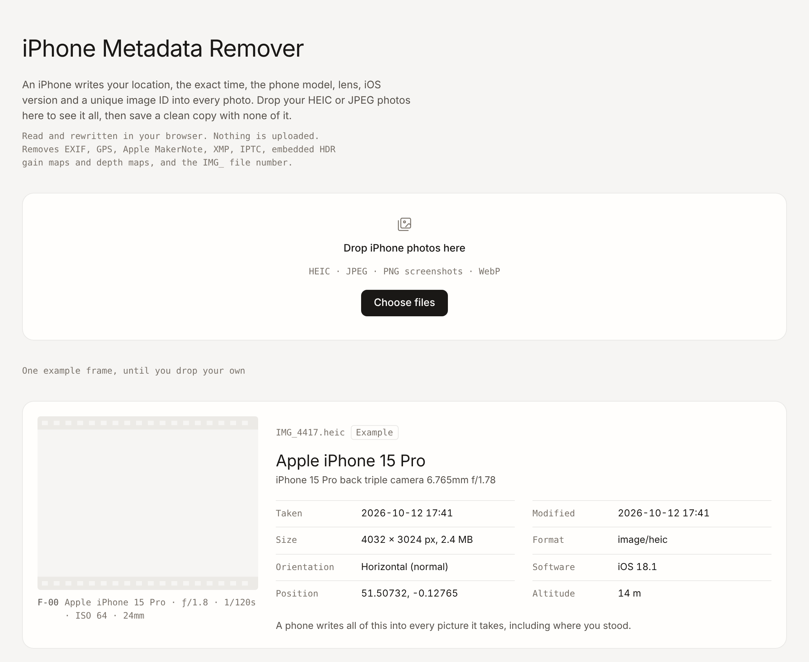

# iPhone Metadata Remover

**Strip location, timestamps, device details and hidden images from iPhone photos — entirely in your browser.**

---

## Why

Every photo an iPhone takes carries a record of where and when it was taken and what took it. Share the original file and you share that record too:

| Data | Example | Removed |
|---|---|:---:|
| GPS position and altitude | `51.50732, -0.12765 · 14 m` | ✅ |
| Date and time taken | `2026-10-12 17:41` | ✅ |
| Phone model and lens | `iPhone 15 Pro back triple camera 6.765mm f/1.78` | ✅ |
| iOS version | `iOS 18.1` | ✅ |
| Apple MakerNote (unique image ID, scene data) | `ContentIdentifier`, `RunTime` | ✅ |
| XMP / IPTC blocks | editing history, captions | ✅ |
| Embedded HDR gain map, depth map, Portrait matte | extra images appended to the JPEG, each with its own EXIF | ✅ |
| Photo counter in the filename | `IMG_4417.HEIC` → `photo-0e6fd6f8.jpg` | ✅ |
| Colour profile (ICC) | Display P3 | Kept — it identifies nobody and keeps colours correct |

## Download

| Option | Link |
|---|---|
| **Use it online** | **https://o2trap.github.io/metadata-remover/** |
| Download the single file | [`index.html`](https://github.com/o2trap/metadata-remover/raw/HEAD/index.html) (right-click → *Save link as…*) |
| Download the whole repo | [ZIP](https://github.com/o2trap/metadata-remover/archive/HEAD.zip) |
| Clone | `git clone https://github.com/o2trap/metadata-remover.git` |

There is nothing to install. The tool is one HTML file.

## How to use

### On iPhone

1. Open **https://o2trap.github.io/metadata-remover/** in **Safari**.
2. Tap **Choose files** → **Photo Library**, and pick one or more photos.
3. Review what each photo records.
4. Tap **Remove metadata** on one photo, or **Clean and save** for all of them.
5. Press and hold the clean preview → **Save to Photos**, or save to Files.

### On a computer

1. Open the online version, or double-click the downloaded `index.html`.
2. Drag photos onto the page (AirDrop them from your iPhone first, or export from Photos with **File → Export → Export Unmodified Original**).
3. Click **Clean and save**. Several photos are saved together as `clean-photos.zip`.

### Verify the result

Drop the clean copy back onto the page. It should report **"Nothing recorded"**.

## Browser support

| Browser | JPEG / PNG | HEIC |
|---|:---:|:---:|
| Safari (iOS, macOS) | ✅ | ✅ native |
| Chrome, Edge, Firefox | ✅ | ✅ via [heic2any](https://github.com/alexcorvi/heic2any) |

If a HEIC photo won't convert, try Safari, or set the iPhone to shoot JPEG: **Settings → Camera → Formats → Most Compatible**.

## How it works

- **JPEG (not rotated)** — the file is rewritten byte for byte without its `APP1`–`APP15` and comment segments, and cut off at the first end-of-image marker so appended gain-map and depth images go too. Pixels are untouched.
- **HEIC, rotated JPEG, WebP** — the image is decoded, drawn to a canvas with its rotation applied, and re-encoded as a fresh JPEG/WebP at 95% quality. A canvas carries no metadata.
- **PNG** — only rendering chunks (`IHDR`, `IDAT`, `PLTE`, `iCCP`, …) are kept; `eXIf`, `tEXt`, `iTXt` and `zTXt` are dropped.
- **Check** — every clean file is parsed again with [exifr](https://github.com/MikeKovarik/exifr), and the page reports anything still left.

## Privacy

- Your photos never leave your device. There is no server, no upload, no analytics.
- The page loads two open-source libraries from the jsDelivr CDN (`exifr` and `heic2any`). Once loaded, the tool works without sending anything.

## Limitations

- Re-encoding (HEIC and rotated photos) is lossy at 95% JPEG quality.
- Live Photo video, RAW/ProRAW (DNG) files and videos are not supported. RAW files can be inspected but not cleaned.
- Removing metadata does not remove what's *in* the picture — faces, street signs, reflections and screens can still identify a place.

## Credits

Built on [exifr](https://github.com/MikeKovarik/exifr) and [heic2any](https://github.com/alexcorvi/heic2any).
